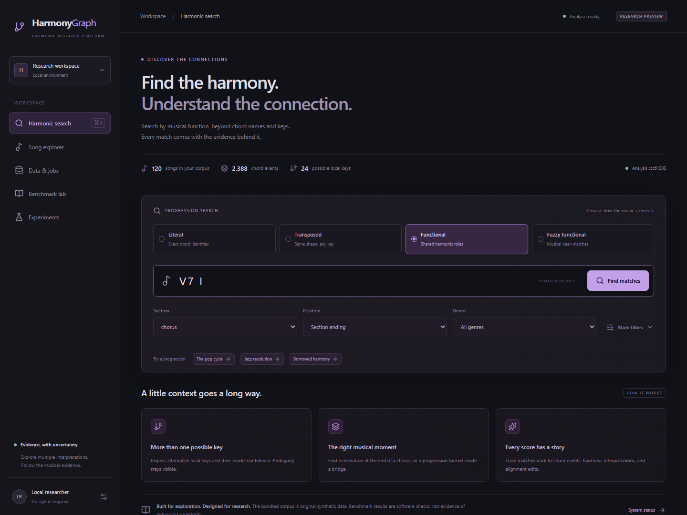

# HarmonyGraph

An uncertainty-aware, section-sensitive harmonic search application and research workbench. Search chord passages, inspect competing local-key readings, trace each score to stored evidence, and run reproducible baseline and optimization experiments.



## Start with Docker

Requires Docker Desktop with its Linux engine running.

```powershell
Copy-Item .env.example .env
docker compose up --build -d
```

Open **http://localhost:8080**. In **Data & jobs**, select **Load synthetic demo**. The worker imports 120 original synthetic songs, analyzes/indexes them, and creates a 120-query benchmark. Progress and failures appear in the job list. OpenAPI documentation is at **http://localhost:8000/docs**.

```powershell
docker compose logs -f worker
docker compose exec api harmonygraph search "V7 I" --section chorus --boundary end
```

Only the web and API are exposed, on localhost. PostgreSQL remains internal. This is a local research application without authentication. Synthetic judgments are constructed test fixtures, never expert labels.

## Native Windows development

Python 3.12 and Node 20.19+ or 22.12+ are required. The fallback database is SQLite. A separate PostgreSQL integration test is provided; its execution status is recorded in the verification report.

```powershell
python -m venv .venv
.\.venv\Scripts\python -m pip install -r requirements-dev.lock
.\.venv\Scripts\python -m pip install --no-deps -e .
.\.venv\Scripts\python -m harmonygraph.cli migrate
.\.venv\Scripts\python -m harmonygraph.cli demo
.\.venv\Scripts\python -m harmonygraph.cli serve
```

In a second terminal:

```powershell
.\.venv\Scripts\python -m harmonygraph.jobs
```

In a third terminal:

```powershell
cd web
npm ci --cache .npm-cache
npm run dev
```

Open **http://127.0.0.1:5173**. Alternatively, `scripts/start.ps1` installs dependencies and starts hidden development processes; `scripts/start.ps1 -Docker` starts Compose.

If ports are occupied, run the API with `serve --port 8010`, set `$env:API_PROXY_TARGET='http://127.0.0.1:8010'`, and run `npm run dev -- --port 5180 --strictPort`. The frontend proxies API calls on its own origin.

## Workflows

**Search:** literal and transposed modes accept chord symbols (`C G Am F`). Functional modes accept Roman numerals (`I V vi IV`, `ii7 V7 Imaj7`, `V7/V V I`, `bVI bVII I`). Separate tokens with spaces, bars, commas, or spaced dashes. Queries contain 1–32 events. Hard filters restrict section, boundary, genre, year, and candidate local key; optional section/boundary preferences affect ranking. Fuzzy matching permits up to two extra or missing events in the candidate window.

**Song explorer:** inspect original events, section boundaries, full local-key posterior data, functional alternatives, harmonic relations, and raw source annotations. Confidence is explicitly model confidence; calibration requires evaluation.

**Benchmark lab:** select or create local annotator profiles, build candidate pools, and assign relevance 0–2 plus optional explanation ratings 1–5. Independent views hide others' judgments. Explicit review mode exposes history and permits adjudication. Every submission is retained. Editing a query creates a new benchmark revision and annotation round, preserving earlier definitions and judgments.

**Experiments:** compare B1–B6 and the proposed configuration; add eight ablations; inspect confidence intervals and export JSON/CSV. Quick web runs use six queries per split. Final test evaluation requires a matching frozen manifest.

## Dataset imports

Place inputs under `data/imports/` for web/worker imports. The CLI accepts an explicit local path. No real corpus is downloaded or redistributed automatically.

```powershell
harmonygraph import data/imports/chordonomicon.csv --source chordonomicon --name Chordonomicon --license CC-BY-NC-4.0
harmonygraph import data/imports/McGill-Billboard --source billboard --name Billboard --license CC0-1.0
harmonygraph import data/imports/isophonics/manifest.json --source isophonics --name Isophonics
harmonygraph analyze
```

See [implementation map](docs/architecture.md) for service boundaries, versioning, and retrieval limits.

See [dataset formats](docs/datasets.md) for canonical JSONL, Isophonics manifests, source format details, attribution, and validation behavior. Imports are streaming, resumable by source ID, and idempotent within a fingerprinted release. Changed source files create a distinct dataset release. Check unknown-label counts before conducting experiments.

## Research commands

Use a benchmark ID from the web UI or `GET /api/v1/benchmarks`.

```powershell
harmonygraph evaluate BENCHMARK_ID --split validation
harmonygraph evaluate BENCHMARK_ID --split validation --ablations
harmonygraph optimize BENCHMARK_ID --trials 3
harmonygraph optimize BENCHMARK_ID --research
harmonygraph optimize BENCHMARK_ID --trials 150 --sampler random
harmonygraph freeze BENCHMARK_ID --configuration-id CONFIGURATION_HASH
harmonygraph evaluate BENCHMARK_ID --split test --config selected-config.json
harmonygraph export EXPERIMENT_ID
harmonygraph candidate-audit "V7 I" --section chorus
harmonygraph performance --repeats 10
```

Save a configuration's `parameters` object from `/api/v1/configurations` as `selected-config.json` before evaluating it. A 150-trial research optimization is explicit and potentially expensive. All tuning uses validation data; test feedback is excluded. Transfer slices are available through `evaluate --domain` with a JSON filter object containing genre, year range, or dataset IDs.

Pooled recall is labeled as such. Unjudged results contribute no gain but are counted separately from explicit negative judgments. Missing expert references produce unavailable metrics, not invented numbers. The paper scaffold is [docs/paper.md](docs/paper.md).

## Verification

```powershell
.\.venv\Scripts\python -m pytest -q
.\.venv\Scripts\python -m ruff check harmonygraph tests scripts
.\.venv\Scripts\python scripts/export_openapi.py
cd web
npm run types
npm run build
npx playwright install chromium
npm run test:e2e
```

Browser tests require the demo-loaded API, worker, and frontend to be running. Set `BASE_URL` when testing a nondefault frontend port. PostgreSQL tests require `TEST_POSTGRES_URL` pointing at a disposable database. CI supplies PostgreSQL and runs the Python checks, production build, and browser scenarios.

See [verification results](docs/demo-results.md) for checks actually executed in this delivery, rather than treating the presence of a test as proof it passed.

## Operational details

Jobs use row locking, leases, a heartbeat, cooperative cancellation, and stale-job recovery. Failed analyses never replace the active version. Cache entries contain immutable per-song snapshots and are bounded to 256 songs / 50,000 events. APIs expose status and timing; worker logs include job IDs. Dataset and experiment jobs perform expensive work offline.

Back up PostgreSQL without PowerShell binary redirection:

```powershell
docker compose exec db pg_dump -U harmony -d harmonygraph -Fc -f /tmp/harmonygraph.dump
docker compose cp db:/tmp/harmonygraph.dump ./harmonygraph.dump
```

Restore into an empty replacement database, after stopping API and worker writes:

```powershell
docker compose cp ./harmonygraph.dump db:/tmp/harmonygraph.dump
docker compose exec db pg_restore -U harmony -d harmonygraph /tmp/harmonygraph.dump
```

Database migrations run before API/worker startup. `harmonygraph index` runs the versioned analysis/index pipeline; a ready matching version is reused. Dependency lockfiles are `requirements.lock`, `requirements-dev.lock`, and `web/package-lock.json`. Application migrations use `harmonygraph_schema_version`; Optuna retains its own version table. Docker report files live in the `artifacts_data` volume and can be copied out with `docker compose cp worker:/app/artifacts ./exported-artifacts`.

## Research boundaries

The implementation is a research prototype with heuristic major/minor harmony rules. Full-corpus scalability, expert-verified relevance, confidence calibration, and scientific superiority remain empirical work. No audio recognition, music generation, embeddings, graph database, cloud deployment, or authenticated team accounts are included.
